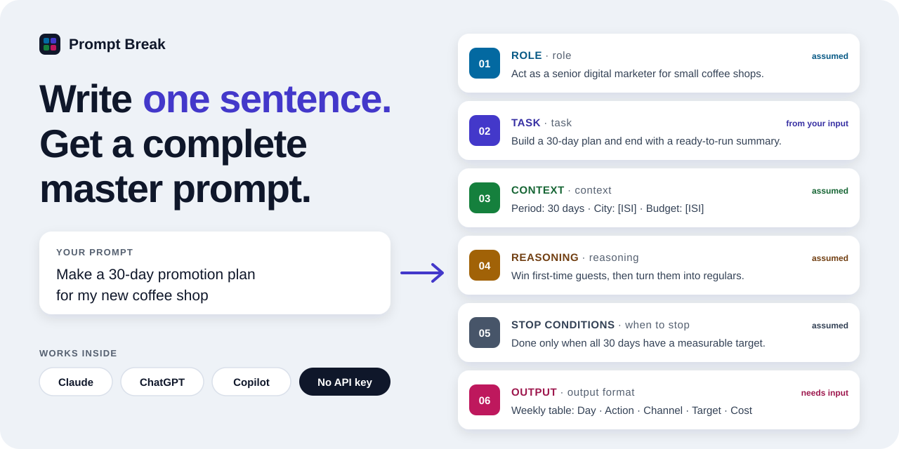

<div align="center">

# ⚡ Prompt Break

### Write one sentence. Get a complete master prompt.

Turn a quick request into a sharp, six-part prompt,<br>
right inside the **Claude**, **ChatGPT**, and **Copilot** you already use every day.




</div>

---

## Why do AI answers often feel... generic?

You type *"make a promotion plan for my coffee shop"*, and the AI replies with tips that
would fit any coffee shop on the planet. It's not the AI's fault. It's guessing.
It doesn't know your city, your budget, or what a good result looks like to you.

**Prompt Break stops the guessing.** Your one sentence gets dissected into six parts.
What's clear gets filled in, what's missing gets marked `[FILL IN]`,
and you get a few quick questions so the final prompt is truly yours.

## The six parts that make a prompt work

| | Part | What it answers |
|:-:|---|---|
| `01` | **Role** | Who the AI should be, and what it should prioritize |
| `02` | **Task** | The specific job to finish, and how it should wrap up |
| `03` | **Context** | The facts the AI needs: location, audience, budget, team |
| `04` | **Reasoning** | The end goal, plus a request to explain the "why" behind each step |
| `05` | **Stop conditions** | When the work counts as done, so answers never trail off |
| `06` | **Output** | The shape of the result: table, list, which columns |

## ✨ What makes it different

- **Lives inside your chat.** No extra website to open. It shows up right in the conversation.
- **No API key, no extra cost.** The AI doing the work is the one in your own account.
- **Honest about what it doesn't know.** It never makes up numbers or names; gaps are marked `[FILL IN]`.
- **Completeness score.** See at a glance how "ready" your request is.
- **Edit anything, copy in one click.** Polish each part, then paste it into any AI.
- **Light and safe.** Zero npm dependencies, stores nothing, calls no other servers.

> 🌏 Speaks English and Indonesian. The interface follows your chat app's language (or the language you write in), and the AI writes your prompt in whatever language you use.

## 🚀 Add it to your AI

### ✨ Easiest: let your AI install it

Using **Claude Code**, **Codex**, **Gemini CLI**, **GitHub Copilot** (Agent mode),
**Cursor**, or **Windsurf**? Paste this into the chat:

```
Install Prompt Break from https://github.com/V-Jfira/PromptBreak by following INSTALL.md
```

Your AI reads [INSTALL.md](INSTALL.md), installs Node.js and Git if they're missing,
and adds Prompt Break to every AI app it finds on your computer, including the
Claude Desktop chat. It asks before changing anything.

### Or set it up yourself

> Requires [Node.js](https://nodejs.org) 18+ and [Git](https://git-scm.com).

**First, install it once** (takes a few seconds):

```bash
npm install -g github:V-Jfira/PromptBreak
```

Then run `npm root -g`. The server lives in that folder at `prompt-break/mcp/server.js`;
the examples below call this full path `SERVER_PATH`. For example, on Windows:
`C:\\Users\\you\\AppData\\Roaming\\npm\\node_modules\\prompt-break\\mcp\\server.js`
(use double backslashes inside JSON).

To update later, run the same install command again and restart your apps.

<details>
<summary><b>Claude Desktop</b></summary>

1. Open **Settings → Developer → Edit Config**.
2. Add this to `claude_desktop_config.json`:

```json
{
  "mcpServers": {
    "prompt-break": {
      "command": "node",
      "args": ["SERVER_PATH"]
    }
  }
}
```

3. Quit and reopen Claude Desktop.
</details>

<details>
<summary><b>VS Code (GitHub Copilot Chat)</b></summary>

Create `.vscode/mcp.json`:

```json
{
  "servers": {
    "prompt-break": {
      "type": "stdio",
      "command": "node",
      "args": ["SERVER_PATH"]
    }
  }
}
```

Then open Copilot Chat in Agent mode.
</details>

<details>
<summary><b>Claude.ai (web) and ChatGPT (coming soon)</b></summary>

🚧 **Coming soon.** These apps run in the browser, so they need Prompt Break hosted
online and added as a custom connector. A ready-to-use address isn't available yet;
for now, use Claude Desktop, Claude Code, VS Code, Cursor, or another app above.

For developers who want to try it early: the repo includes an online server
(`api/mcp.js`) meant for [Vercel](https://vercel.com). Once deployed, add
`https://<your-site>.vercel.app/api/mcp` as a custom connector. This setup hasn't
been tested yet.
</details>

## 💬 How to use it

Once it's installed, just chat like you normally would:

> **You:** Build a master prompt with Prompt Break for: a 30-day promotion plan for my new coffee shop

Prompt Break appears in the chat with all six parts filled in.
Type answers into the boxes under its questions (all optional) and hit **Add my answers**: the prompt updates instantly. Want the AI to rework everything with your answers? Click the small **or ask Claude to polish the whole prompt** link below it (the name follows your chat app). Then **Copy master prompt**. Done.

Prefer to type in the tool itself? Just say **"Open Prompt Break"**: an empty Prompt Break appears, type your sentence there and hit **Analyze**.

In apps that support slash commands, you can also type `/promptbreak`.

## 🔒 Privacy

- Prompt Break doesn't store your prompts or send them anywhere.
- The content is written by the AI in your own account; the server only displays it.

## 🗂️ What's inside

```
mcp/        MCP server + the in-chat interface (the heart of this tool)
api/mcp.js  online MCP server (Vercel)
docs/       README banner
INSTALL.md  install steps for AI assistants
LICENSE     PolyForm Shield 1.0.0
```

Technical details for developers are in [mcp/README.md](mcp/README.md).

## 👤 Credits

Created by **Valdy** ([@V-Jfira](https://github.com/V-Jfira)) · [valdytapahing@gmail.com](mailto:valdytapahing@gmail.com)

## 📄 License

Prompt Break is source-available under the [PolyForm Shield License 1.0.0](LICENSE).

- ✅ **Free to use** for anything, at home or at work, including in your business.
- ✅ **Free to change** for your own use.
- ❌ **Not for resale:** you may not sell Prompt Break or a modified version, or offer
  any product that competes with it (even for free).
- Keep the `Required Notice` line from [LICENSE](LICENSE) with any copy you share.

Questions about other uses? Reach out at [valdytapahing@gmail.com](mailto:valdytapahing@gmail.com).

---

<div align="center">

Made for anyone who wants AI to actually get what they mean. 🧡<br>
Like it? Leave a ⭐ so more people can find it.

</div>
